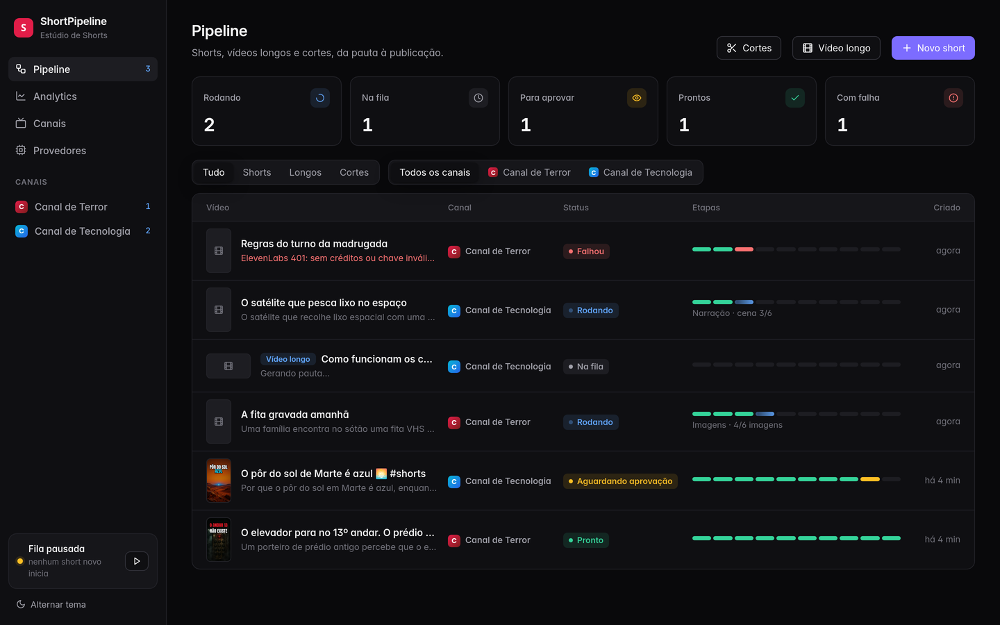
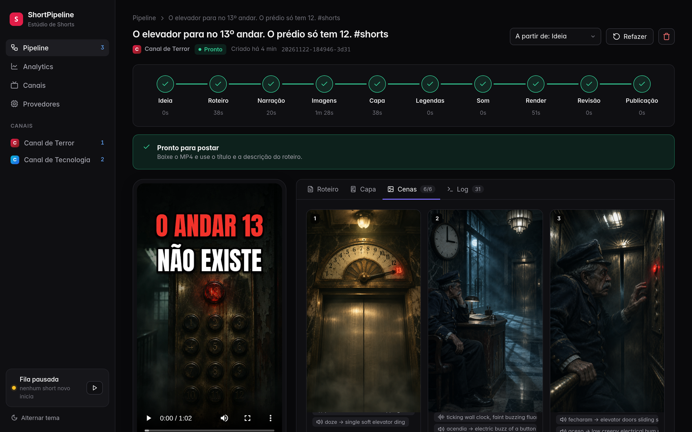
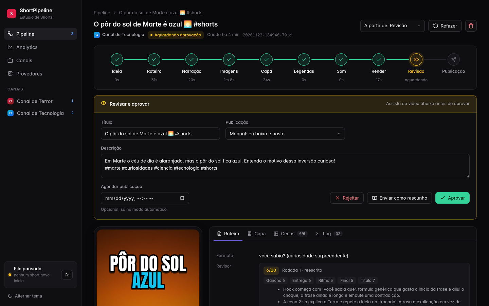
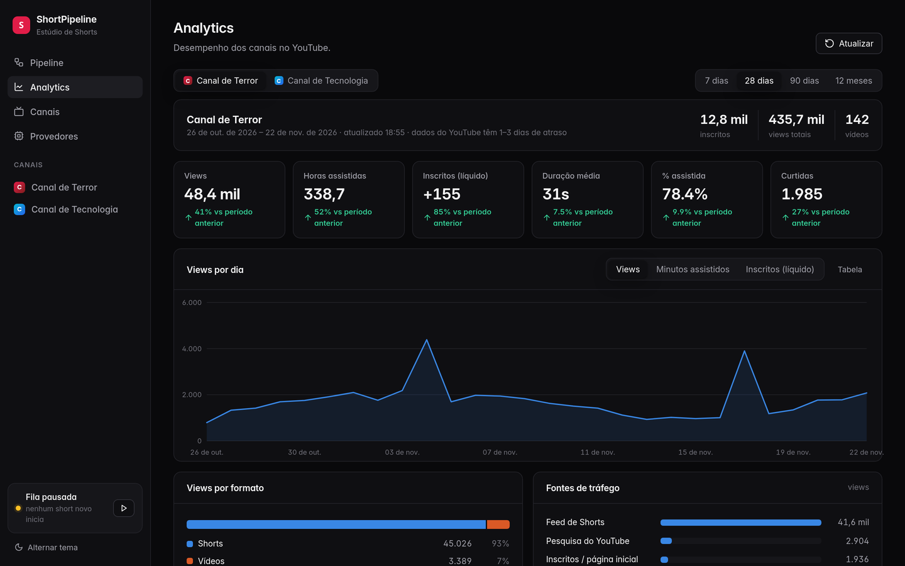
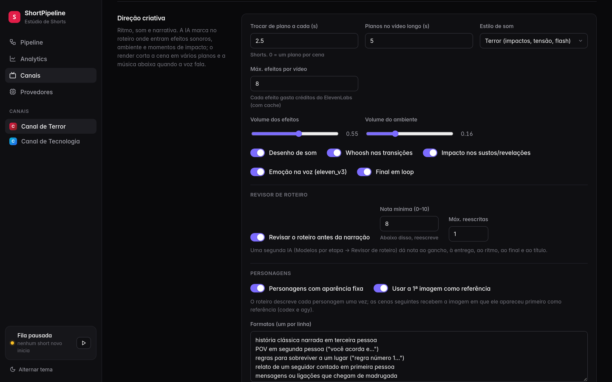

# ShortPipeline

**English** · [Português](README.md)

A video factory for YouTube: it automatically makes **Shorts**, **long-form videos** and **clips** cut from long videos, for as many channels as you want, with a web dashboard that shows which stage each video is in and lets you choose which AI does what.

Text and image AIs run through **CLIs logged in with your own account** (`claude`, `codex` and `agy`), with no API keys. Narration uses ElevenLabs, with the free Edge TTS as a fallback.

> The dashboard and the default prompts are in Brazilian Portuguese. The language of the videos is set per channel.

```
Idea → Script → Narration → Images → Cover → Captions → Sound → Render → Review → Publish
```



## Screenshots

| | |
|---|---|
|  |  |
| **Video**: player, stages with timings, scenes with sound effects and ambience | **Approval**: title, description, publish, schedule or upload as a draft; script critic scores |
|  |  |
| **Analytics**: views, retention, subscribers, traffic sources and what the channel has learned | **Channels**: model per stage, voice, prompts and creative direction |

<sub>Screenshots from a demo environment: channels, videos and numbers are fictional.</sub>

## What it does

| Stage | What happens | Providers |
|---|---|---|
| Idea | picks the topic: the AI suggests one without repeating past titles, or takes a fresh story from an RSS feed | Claude / Codex / Gemini (agy) |
| Script | title, description, tags and scenes (narration + image prompt); then a **critic** scores the hook, pacing, ending and title, and rewrites the script if it falls below the bar | Claude / Codex / Gemini (agy) |
| Narration | voice per scene with timing for every word; with `eleven_v3`, emotion tags (`[whispers]`, `[scared]`…) | ElevenLabs / Edge TTS |
| Images | one image per scene; characters keep a fixed look, using each one's first image as a reference for the next scenes | Codex / Gemini (agy) / placeholder |
| Cover | image with short text; shown in the first frames and uploaded as the thumbnail | AI or a scene image |
| Captions | karaoke style, highlighting the spoken word | — |
| Sound | sound effects on the right word, ambience per scene, whooshes on transitions and impacts on scares/reveals | ElevenLabs (cached) or synthesized sounds |
| Render | several shots per scene (cuts that follow the speech), transitions, channel effects, flash/shake on impacts, music that ducks under the voice | ffmpeg |
| Review | waits for your approval in the dashboard (optional per channel) | — |
| Publish | manual (download the MP4), **draft** (uploads as private without notifying subscribers, so you finish it in YouTube Studio) or automatic, with scheduling | YouTube Data API |

Every AI stage has a main provider and a fallback that takes over when the main one fails (quota, errors). `*_API_KEY` variables are removed from the CLIs' environment, so usage never falls back to paid API billing.

### Creative direction

Per channel: cut pacing, sound design, emotion in the voice, loop endings (the last line flows into the first) and a list of **formats** the pipeline rotates through (e.g. "second-person POV", "myth or fact").

### Channel branding

Elements repeated in every video so viewers recognize the channel in a second, without delaying the hook:

- **Fixed narrator**: one character who tells every video, described in a sentence.
- **Sign-off line**: the last line of every video.
- **Numbered series**: each short gets the next number (e.g. "Episode #12" in the description and an "EP. #012" badge on the cover).
- **Rating badge**: the AI gives a 0–10 score in the script, using the criteria you set (e.g. how hard a recipe is, how overhyped a story is), and an animated bar shows it in the last seconds.
- **Sonic logo**: a short sound, generated once, at the point where the video loops back to the start.

Sound styles available: Neutral (fits any niche), Horror and Tech.

### Topics

Under **Canais → Pauta** (Channels → Topics), set topics to explore, topics to avoid and the editorial tone. Automatic topics go through a selection that compares candidates with the channel's recent and queued videos. If the feed stories are rejected, the AI suggests alternatives. A topic you type in yourself takes priority.

When creating a short, the **Pautas em alta** (Trending topics) button lists current Google Trends searches with their related news, so you can pick one with a click.

### Timeline before rendering

Before rendering, the video's **Timeline** tab shows the tracks like an editor does (scenes, captions, narration, sound effects and ambience), with a preview that plays the voice and sound. From there you can:

- ask the AI for a correction, delete a scene or a sound, and edit a scene's narration;
- insert a sound effect at the playhead (whoosh, impact, riser, blip, an effect described in text, or your own audio file);
- balance voice, music and effects in the **Mixer de áudio** (audio mixer);
- replace a scene's image or video and, under **Imagem e animação**, compare an upscaled version (Real-ESRGAN) and animated templates (Motion Canvas);
- after rendering, **Checar render** (check render): resolution, duration and loudness, plus dark, static or silent sections.

**Canais → Vídeo** holds the scene transitions (*Whip Pan*, *Zoom Punch*, *Cinematic*, *Glitch* or a hard cut), camera motion (zoom, horizontal or vertical pan, or **Automático**, which alternates) and animated emojis in the captions.

### Learning from Analytics

Once the channel is connected, the pipeline periodically reads how the videos actually performed (views, % watched, retention curve) and an AI sums up **what to repeat and what to avoid**. These learnings go into the idea, script and critic prompts, and the formats that perform best get picked more often. The dashboard's **Analytics** page shows views, retention, subscribers, traffic sources and the videos published by the pipeline.

### Long-form videos

The same flow in 16:9: a long script with chapters, one image every N seconds, a 1280×720 thumbnail and chapters in the description. The length is configurable.

### Clips

Turns a long video (link or file) into several shorts:

```
Download → Transcription → Selection  ⟶  one job per segment: Crop → Cover → Captions → Render → Review → Publish
```

- **Transcription** with word timings: local Whisper (CPU, free) or ElevenLabs Scribe.
- **Selection**: the AI picks the segments with the best hooks and explains why; clips start and end on whole words.
- **Crop**: reframes to 9:16 following the speaker's face (OpenCV/YuNet), with a blurred background or a center crop as alternatives.

Only use videos you own or have permission to clip.

## Installation

Requirements:

- [`uv`](https://docs.astral.sh/uv/) and Python 3.12
- `ffmpeg` with libass
- At least one AI CLI, logged in: [`claude`](https://docs.claude.com/en/docs/claude-code), [`codex`](https://github.com/openai/codex) or `agy` (Google Antigravity)
- Optional: an [ElevenLabs](https://elevenlabs.io) API key (without it, narration uses Edge TTS and sound design uses the bundled sound packs or synthesized effects)
- Optional: Node.js for the animated templates (Motion Canvas) and Real-ESRGAN for image upscaling (see below)

```bash
git clone https://github.com/IsaelSousa/shortpipeline
cd shortpipeline
uv run shortpipeline          # opens at http://localhost:8765
```

In the dashboard:

- **Pipeline**: create shorts, long-form videos or clips and follow each stage live. In a video you can see the script, critic scores, images, sound, timeline and log, then approve it, edit it or redo it from any stage.
- **Analytics**: channel metrics and what the pipeline has learned.
- **Canais** (Channels): model per stage, voice, prompts, creative direction, visual style, captions, cover, review (optionally approving before the render), publishing and automatic schedule.
- **Provedores** (Providers): CLI status, ElevenLabs API key, transcription, YouTube, Instagram, notifications and connection diagnostics.

### Your own sounds and music

**Background music**: put MP3s in `assets/music/<channel-id>/`. One is picked at random per video. The folder is ignored by git.

**Effects and ambience**: create a folder in `data/sound-packs/` (also ignored by git, for sounds you can't redistribute, such as Pixabay's) and name the files after the kind of sound:

```
data/sound-packs/my-horror-sounds/
  pack.json        {"styles": ["terror"], "tags": {"ambience": ["paranormal", "eerie"]}}
  impact.mp3       used on scares and reveals instead of the default impact
  scream-1.mp3     variations of the same sound: one is picked at random each time
  scream-2.mp3
  ambience-1.mp3   default ambience when ElevenLabs isn't available
  ambience-rain.mp3
```

- `whoosh`, `impact`, `riser` and `blip` replace the default transition and beat sounds.
- Any other name (`scream`, `door`, `thunder`…) becomes an effect the script can ask for. It's used when the effect's description contains the word, in English or Portuguese (e.g. "woman screaming" or "grito" use a `scream`). The script AI gets the list of available sounds.
- `ambience` and `ambience-<word>` are ambience beds, picked from the scene's description.
- `pack.json` is optional. `styles` limits the pack to channel sound styles, and `tags` adds keywords.
- In the timeline, **Adicionar SFX** (Add SFX) lists your sounds under **Sua biblioteca** (Your library).

Your sounds take priority over ElevenLabs. The CC0 packs in `assets/sound-packs/` are only used when nothing else is available.

### Motion Canvas and Real-ESRGAN (optional)

**Motion Canvas.** With Node.js installed, run in `motion-canvas/`:

```bash
npm ci
npx playwright install chromium   # Chromium only renders the templates, locally
npm run build
```

**Real-ESRGAN.** Put the `realesrgan-ncnn-vulkan` executable on your PATH or in `data/tools/realesrgan/`, with `realesrgan-x4plus.param` and `realesrgan-x4plus.bin` in a `models/` subfolder next to it. Vulkan is required. Upscaling is optional and keeps the original image. [Official release](https://github.com/xinntao/Real-ESRGAN/releases/tag/v0.2.5.0)

## Connecting YouTube (upload, drafts and Analytics)

1. In the [Google Cloud Console](https://console.cloud.google.com/), create a project and enable the **YouTube Data API v3** and the **YouTube Analytics API**.
2. In *Google Auth Platform*, set up the consent screen and add your email as a test user.
3. Create an OAuth client of type **Desktop app** and save the JSON to `data/youtube/client_secret.json` (or set the path in the dashboard).
4. In the dashboard, under **Canais**, click **Conectar YouTube** and pick the channel's account. Do it on the machine running the server (`localhost`), because the login redirect points to `localhost`.

Until your Google app is verified, videos uploaded through the API stay private. The cover is uploaded as the thumbnail for drafts and scheduled videos too.

## Publishing to Instagram Reels

Uploads go through the Meta Graph API v21.0 with a direct file upload, so you don't need a public domain or ngrok.

1. In [developers.facebook.com](https://developers.facebook.com/), create a Business app and add the **Instagram Graph API**.
2. Generate a long-lived access token (60 days) with the `instagram_basic` and `instagram_content_publish` permissions.
3. Get your **Instagram Business Account ID**.
4. In the dashboard, under **Provedores** (or **Canais**), enter the token and the account ID.
5. Under **Canais → Revisão e publicação**, turn on automatic Reels publishing, or use the **Publicar no Reels** button on a finished video.

## Telegram and Discord notifications

Get a message with the cover when a video is waiting for approval, gets published or fails:

- **Telegram**: create a bot with [@BotFather](https://t.me/BotFather), get its token and your chat ID, fill them in under **Provedores** and click **Enviar teste no Telegram** (send test).
- **Discord**: in a channel of your server, create a webhook under *Integrations*, copy its URL and save it under **Provedores**.

## Network access

By default the dashboard only accepts connections from the machine it runs on. To open it on your phone:

```bash
SHORTPIPELINE_HOST=0.0.0.0 uv run shortpipeline
```

The dashboard **has no login**: anyone who can reach it sees the settings, including the ElevenLabs API key, the Instagram token, the Telegram bot token and the Discord webhook, and can create or publish videos. Only use it on a trusted network, or use a VPN such as Tailscale.

## Data

Everything of yours lives in `data/`, which is not tracked by git: `config.json` (edited from the dashboard, includes keys and tokens), `pipeline.db` (queue and logs), `jobs/<id>/` (script, audio, images, captions and `final.mp4`), `youtube/` (OAuth tokens), `learn/` (learnings), `sound-packs/` (your sounds), `sfx_cache/`, `previews/` and `tools/`.

Optional environment variables: `SHORTPIPELINE_PORT`, `SHORTPIPELINE_HOST`, `SHORTPIPELINE_DATA`, `ELEVENLABS_API_KEY`.

## Development

```bash
uv run --group dev pytest       # tests (need ffmpeg)
uvx ruff check shortpipeline tests
```

Tests run in a temporary data folder with mocked AI and voice, so they use no quota and need no logged-in CLIs. One of them makes a whole short, from script to `final.mp4`. GitHub Actions runs everything on every push.

Where things live:

| Folder | Contents |
|---|---|
| `shortpipeline/pipeline/` | the stages: `writing` (idea, script, critic), `media` (narration, images, cover, captions), `assembly` (sound, render, review, publishing), `clips` (clips) and `runner` (stage order) |
| `shortpipeline/routes/` | the dashboard API: `jobs`, `timeline`, `channels` and `integrations` (YouTube, Analytics, notifications, diagnostics) |
| `shortpipeline/providers/` | calls to the AI CLIs, voice, image and transcription |
| `web/js/` | the dashboard, one file per page (plain JavaScript, no build step) |
| `tests/` | pytest tests |

## Responsible use

- Follow YouTube's policies on AI-generated content and label altered or synthetic content when the platform asks.
- YouTube limits monetization of repetitive or reused content without your own contribution; review what goes live.
- For clips, only use material you own or are authorized to use.

## License

Code released under the [MIT License](LICENSE).

### Motion-design references

- **mg-styles-15**, by Vincentwei1021. Its original code, prompts, documentation, and films are MIT-licensed. Third-party material keeps its own terms, including OFL fonts and BSD-3-Clause highlight.js. [MIT license](https://github.com/Vincentwei1021/mg-styles-15/blob/main/LICENSE) · [Asset licenses](https://github.com/Vincentwei1021/mg-styles-15#license)
- **motion-prompt**, by Shohei Ohtaki. Its original code, images, and videos may be used commercially under MIT. Keep the element's attribution line when reusing its code. Embedded posts belong to their authors. [MIT license](https://github.com/showheyohtaki/motion-prompt/blob/main/LICENSE) · [Third-party notices](https://github.com/showheyohtaki/motion-prompt/blob/main/THIRD-PARTY-NOTICES.md)
- **animate**, by cth9191. Its original code is MIT-licensed. [MIT license](https://github.com/cth9191/animate/blob/main/LICENSE)

Include the original copyright and license notices when distributing copies or substantial portions of MIT-licensed material.

## Credits

- [Motion Canvas](https://github.com/motion-canvas/motion-canvas), under the MIT license, for the animated templates.
- Offline sound effects and ambience by [Kenney](https://kenney.nl) and [OpenGameArt](https://opengameart.org) authors, under CC0. See the [file list, license and how to add packs](assets/sound-packs/README.md).
- [Anton](https://fonts.google.com/specimen/Anton), [Creepster](https://fonts.google.com/specimen/Creepster), [Montserrat](https://fonts.google.com/specimen/Montserrat) and [Inter](https://fonts.google.com/specimen/Inter) fonts, under the [SIL Open Font License 1.1](https://openfontlicense.org) (each license text is in `assets/fonts/` and `web/fonts/`).
- [YuNet](https://github.com/opencv/opencv_zoo/tree/main/models/face_detection_yunet) face detector from OpenCV Zoo, under the MIT license (`assets/models/LICENSE-YuNet.txt`).
