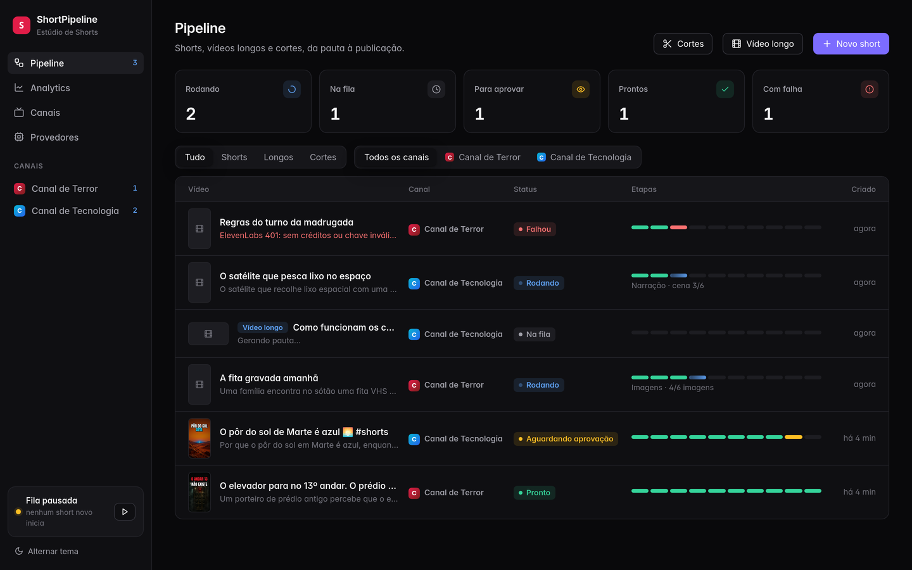
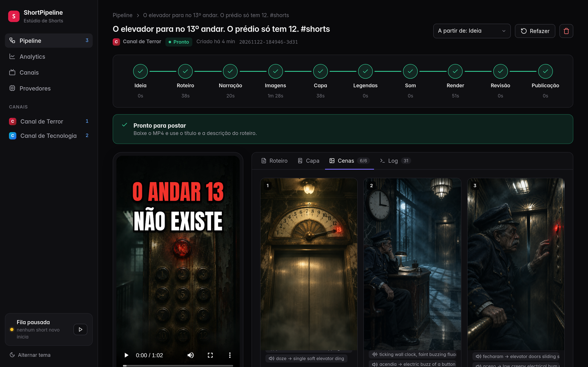
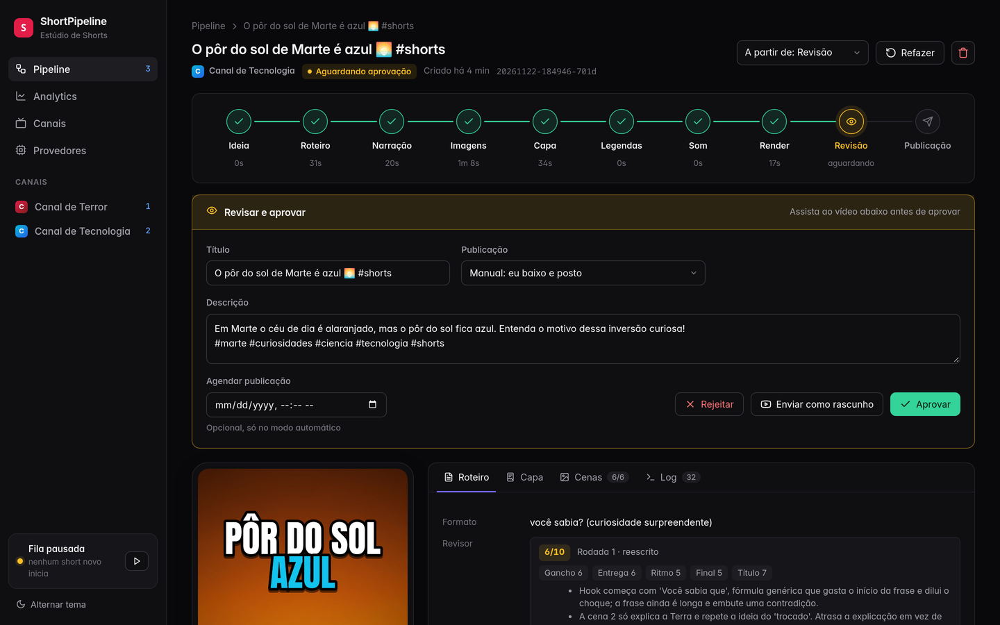
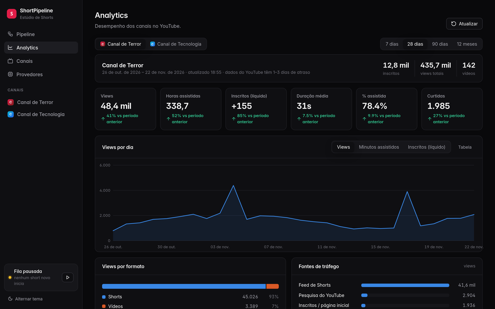
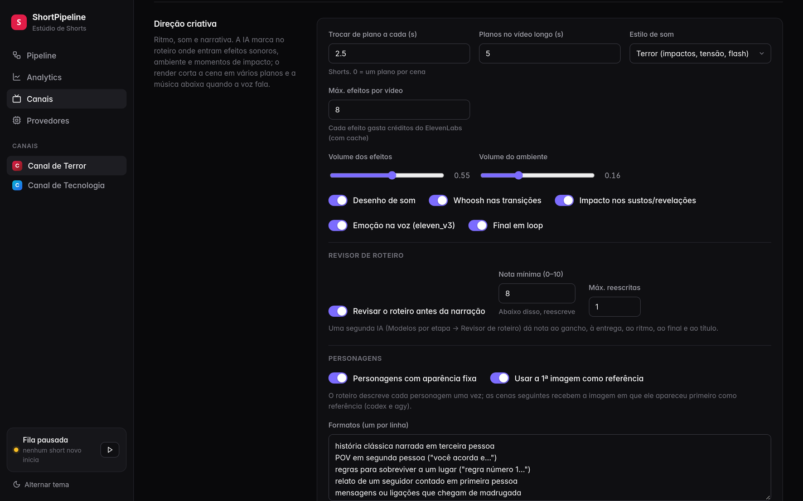

# ShortPipeline

[English](README.en.md) · **Português**

Fábrica de vídeos para YouTube: gera **Shorts**, **vídeos longos** e **cortes** de vídeos longos de forma automática, para quantos canais você quiser, com um painel web que mostra em que etapa cada vídeo está e deixa configurar qual IA faz o quê.

As IAs de texto e imagem rodam pelas **CLIs logadas com a sua conta** (`claude`, `codex` e `agy`), sem API key. A narração usa o ElevenLabs (com o Edge TTS, grátis, como reserva).

```
Ideia → Roteiro → Narração → Imagens → Capa → Legendas → Som → Render → Revisão → Publicação
```



## Telas

| | |
|---|---|
|  |  |
| **Vídeo**: player, etapas com tempo, cenas com efeitos de som e ambiente | **Aprovação**: título, descrição, publicar, agendar ou enviar como rascunho; notas do revisor |
|  |  |
| **Analytics**: views, retenção, inscritos, fontes de tráfego e o que o canal aprendeu | **Canais**: modelos por etapa, voz, prompts e direção criativa |

<sub>Capturas de um ambiente de demonstração: canais, vídeos e números fictícios.</sub>

## O que ele faz

| Etapa | O que acontece | Provedores |
|---|---|---|
| Ideia | escolhe a pauta: a IA sugere evitando repetir títulos, ou pega uma notícia nova de RSS | Claude / Codex / Gemini (agy) |
| Roteiro | título, descrição, tags e cenas (narração + prompt de imagem); depois um **revisor** dá nota ao gancho, ritmo, final e título e reescreve se ficar abaixo do corte | Claude / Codex / Gemini (agy) |
| Narração | voz por cena com o tempo de cada palavra; no `eleven_v3`, marcações de emoção (`[whispers]`, `[scared]`…) | ElevenLabs / Edge TTS |
| Imagens | uma imagem por cena; personagens com aparência fixa, usando a primeira imagem de cada um como referência nas seguintes | Codex / Gemini (agy) / placeholder |
| Capa | imagem com texto curto; entra nos primeiros frames e vai como thumbnail no upload | IA ou imagem de uma cena |
| Legendas | estilo karaokê, com a palavra falada destacada | — |
| Som | efeitos sonoros na palavra certa, ambiente por cena, whoosh nas transições e impacto nos sustos/revelações | ElevenLabs (com cache) ou sons sintetizados |
| Render | vários planos por cena (cortes no ritmo da fala), transições, efeitos do canal, flash/tremor nos impactos, música que abaixa quando a voz fala | ffmpeg |
| Revisão | espera sua aprovação no painel (opcional por canal) | — |
| Publicação | manual (baixar o MP4), **rascunho** (sobe privado, sem avisar inscritos, para terminar no YouTube Studio) ou automática, com agendamento | YouTube Data API |

Cada etapa com IA tem um provedor principal e um de reserva, usado quando o principal falha (cota, erro). As variáveis `*_API_KEY` são removidas do ambiente das CLIs, para nunca cair em cobrança por API.

### Direção criativa

Por canal: ritmo de cortes, desenho de som, emoção na voz, final em loop (a última frase emenda na primeira) e uma lista de **formatos** que o pipeline alterna (ex.: "POV em segunda pessoa", "mito ou verdade").

### Marca do canal

Elementos que se repetem em todo vídeo, para o público reconhecer o canal em um segundo, sem atrasar o gancho:

- **Narrador fixo**: um personagem que conta todos os vídeos, descrito em uma frase.
- **Bordão final**: a última frase de todo vídeo.
- **Série numerada**: cada short ganha o próximo número (ex.: "Episódio #12" na descrição e "EP. #012" num selo na capa).
- **Selo de nota**: a IA dá uma nota de 0 a 10 no roteiro, com o critério que você definir (ex.: dificuldade de uma receita, quanto uma notícia é exagerada), e uma barra animada mostra a nota nos últimos segundos.
- **Assinatura sonora**: um som curto, gerado uma vez, no ponto em que o vídeo volta ao começo.

Os estilos de som disponíveis são Neutro (serve para qualquer nicho), Terror e Tech.

### Aprendizado com o Analytics

Com o canal conectado, o pipeline lê periodicamente o desempenho real dos vídeos (views, % assistida, curva de retenção) e uma IA resume **o que repetir e o que evitar**. Esses aprendizados entram nos prompts de pauta, roteiro e revisor, e os formatos que rendem mais passam a ser escolhidos mais vezes. A página **Analytics** do painel mostra views, retenção, inscritos, fontes de tráfego e os vídeos publicados pelo pipeline.

### Vídeos longos

Mesmo fluxo em 16:9: roteiro longo com capítulos, uma imagem a cada N segundos, thumbnail 1280×720 e capítulos na descrição. A duração é configurável.

### Cortes

Transforma um vídeo longo (link ou arquivo) em vários shorts:

```
Download → Transcrição → Seleção  ⟶  um job por trecho: Recorte → Capa → Legendas → Render → Revisão → Publicação
```

- **Transcrição** com tempo por palavra: Whisper local (CPU, grátis) ou ElevenLabs Scribe.
- **Seleção**: a IA escolhe os trechos com melhor gancho e explica por quê; os cortes começam e terminam em palavras inteiras.
- **Recorte**: reenquadra para 9:16 seguindo o rosto de quem fala (OpenCV/YuNet), com fundo desfocado ou recorte central como alternativa.

Use apenas vídeos seus ou que você tem permissão para recortar.

## Instalação

Requisitos:

- [`uv`](https://docs.astral.sh/uv/) e Python 3.12
- `ffmpeg` com libass
- Pelo menos uma CLI de IA logada: [`claude`](https://docs.claude.com/en/docs/claude-code), [`codex`](https://github.com/openai/codex) ou `agy` (Google Antigravity)
- Opcional: uma API key do [ElevenLabs](https://elevenlabs.io) (sem ela, a narração usa o Edge TTS e o som usa efeitos sintetizados)

```bash
git clone https://github.com/IsaelSousa/shortpipeline
cd shortpipeline
uv run shortpipeline          # abre em http://localhost:8765
```

No painel:

- **Pipeline**: crie shorts, vídeos longos ou cortes e acompanhe cada etapa ao vivo. Num vídeo dá para ver roteiro, notas do revisor, imagens, som e log, conferir a **timeline multi-faixas** estilo editor (cenas, legendas, locução, efeitos/ambientes) com preview em tempo real, pedir correções para a IA ou editar diretamente antes de renderizar, aprovar e refazer a partir de qualquer etapa.
- **Analytics**: métricas do canal e o que o pipeline aprendeu.
- **Canais**: modelos por etapa, voz, prompts, direção criativa, estilo visual, legendas, capa, revisão (com opção de aprovação antes do render), publicação e agenda automática.
- **Provedores**: status das CLIs, API key do ElevenLabs, transcrição e conexões com o YouTube e TikTok (com upload automático de capa para rascunhos e agendados).

Música de fundo: coloque MP3s em `assets/music/<id-do-canal>/`. Um é sorteado por vídeo.

## Conectar o YouTube (upload, rascunho e Analytics)

1. No [Google Cloud Console](https://console.cloud.google.com/), crie um projeto e ative a **YouTube Data API v3** e a **YouTube Analytics API**.
2. Em *Google Auth Platform*, configure a tela de consentimento e adicione o seu e-mail como usuário de teste.
3. Crie uma credencial OAuth do tipo **App para computador** e salve o JSON em `data/youtube/client_secret.json` (ou informe o caminho no painel).
4. No painel, em **Canais**, clique em **Conectar YouTube** e escolha a conta do canal. Faça isso pelo próprio computador (`localhost`), porque o retorno do login aponta para `localhost`.

Enquanto o app do Google não passar pela verificação, os uploads feitos pela API ficam privados.

## Conectar o TikTok (upload e rascunhos)

1. No [TikTok for Developers](https://developers.tiktok.com/), crie um aplicativo de desenvolvedor.
2. Adicione os produtos **TikTok Login Kit** e **Content Posting API**.
3. Em *Redirect URI*, cadastre: `http://localhost:8765/api/tiktok/callback`.
4. No painel, em **Provedores**, insira o **Client Key** e **Client Secret** do TikTok.
5. Em **Canais**, clique em **Conectar TikTok** para autorizar a conta do canal. Você também pode enviar qualquer vídeo renderizado com 1 clique pelo botão **"Enviar para o TikTok"**.

## Publicar no Instagram Reels

Publicação direta de Reels usando a Meta Graph API v21.0 com upload binário resumível direto (sem necessidade de ngrok ou servidor público):
1. Em [developers.facebook.com](https://developers.facebook.com/), crie um aplicativo Empresarial e adicione a **Instagram Graph API**.
2. Gere um Access Token de longa duração (Long-Lived Token, 60 dias) com permissões `instagram_basic` e `instagram_content_publish`.
3. Obtenha o seu **Instagram Business Account ID**.
4. No painel, em **Provedores** (ou em **Canais**), insira o Access Token e o Account ID.
5. Em **Canais → Revisão e publicação**, ative a opção de publicar Reels automaticamente no upload, ou use o botão **"Publicar no Reels"** no modal do vídeo.

## Notificações em Tempo Real (Telegram e Discord)

Receba avisos instantâneos com foto de capa quando um vídeo estiver aguardando aprovação ou for publicado:
- **Telegram**: crie um bot via [@BotFather](https://t.me/BotFather), obtenha o Token e descubra seu Chat ID. Em **Provedores**, preencha e clique em "Enviar teste no Telegram".
- **Discord**: em um canal do seu servidor Discord, crie uma Integração via Webhook, copie a URL e salve em **Provedores**.

## Radar Google Trends & Edição na Timeline

- **Tendências em Alta**: ao criar um novo short, clique em **"🔥 Ver tendências no Google Trends"** para carregar em tempo real as pautas e notícias mais buscadas no Brasil com 1 clique.
- **Mixer de Áudio**: na timeline, use o botão **"Mixer de Áudio"** para ajustar os volumes da voz, da trilha sonora e dos efeitos com sliders de 0% a 200%.
- **Inserir SFX na Agulha**: posicione o cursor na timeline e clique em **"Adicionar SFX"** para inserir Whoosh, Impacto, Riser, Blip ou efeitos sonoros personalizados no segundo exato.
- **Transições Cinematográficas e Emojis**: configure em **Canais → Vídeo** transições como *Whip Pan*, *Zoom Punch*, *Cinematográfica* ou *Glitch*, além de animações de emojis automáticas nas legendas.

## Acesso pela rede

Por padrão o painel só aceita conexões do próprio computador. Para abrir no celular:

```bash
SHORTPIPELINE_HOST=0.0.0.0 uv run shortpipeline
```

O painel **não tem login**: quem acessar vê a configuração (incluindo a API key do ElevenLabs) e pode criar ou publicar vídeos. Use só em rede de confiança, ou prefira uma VPN como o Tailscale.

## Dados

Tudo o que é seu fica em `data/`, que está fora do git: `config.json` (editado pelo painel, inclui a API key), `pipeline.db` (fila e logs), `jobs/<id>/` (roteiro, áudios, imagens, legendas e `final.mp4`), `youtube/` (tokens OAuth), `learn/` (aprendizados) e `sfx_cache/`.

Variáveis opcionais: `SHORTPIPELINE_PORT`, `SHORTPIPELINE_HOST`, `SHORTPIPELINE_DATA`, `ELEVENLABS_API_KEY`.

## Uso responsável

- Siga as políticas do YouTube sobre conteúdo gerado por IA e marque o conteúdo alterado/sintético quando a plataforma pedir.
- O YouTube limita a monetização de conteúdo repetitivo ou reaproveitado sem contribuição própria; revise o que vai ao ar.
- Para cortes, use apenas material seu ou com autorização.

## Movimento de câmera

Em **Canais → Vídeo → Movimento de câmera**, escolha aproximação suave, panorâmica lateral suave ou panorâmica vertical suave. O efeito é aplicado a cada plano das cenas feitas a partir de imagens, em shorts e vídeos longos. A opção **Automático** mantém a alternância de movimentos do canal.

Os movimentos são implementados no renderizador do ShortPipeline com FFmpeg.

## Licença

Código sob a licença [MIT](LICENSE).

### Referências de motion design

- **mg-styles-15**, de Vincentwei1021. O código, os prompts, a documentação e os filmes originais do projeto estão sob MIT. Materiais de terceiros mantêm os próprios termos, entre eles fontes OFL e highlight.js sob BSD-3-Clause. [Licença MIT](https://github.com/Vincentwei1021/mg-styles-15/blob/main/LICENSE) · [Licenças dos materiais](https://github.com/Vincentwei1021/mg-styles-15#license)
- **motion-prompt**, de Shohei Ohtaki. Código, imagens e vídeos próprios podem ser usados comercialmente sob MIT. Preserve a linha de atribuição do elemento ao reutilizar seu código. Os posts incorporados pertencem aos respectivos autores. [Licença MIT](https://github.com/showheyohtaki/motion-prompt/blob/main/LICENSE) · [Avisos de terceiros](https://github.com/showheyohtaki/motion-prompt/blob/main/THIRD-PARTY-NOTICES.md)
- **animate**, de cth9191. O código próprio está sob MIT. [Licença MIT](https://github.com/cth9191/animate/blob/main/LICENSE)

Ao distribuir cópias ou partes substanciais do material MIT, inclua o aviso de copyright e o texto da licença original.

## Créditos

- Fontes [Anton](https://fonts.google.com/specimen/Anton), [Creepster](https://fonts.google.com/specimen/Creepster), [Montserrat](https://fonts.google.com/specimen/Montserrat) e [Inter](https://fonts.google.com/specimen/Inter), sob a [SIL Open Font License 1.1](https://openfontlicense.org) (texto de cada uma em `assets/fonts/` e `web/fonts/`).
- Detector de rostos [YuNet](https://github.com/opencv/opencv_zoo/tree/main/models/face_detection_yunet) do OpenCV Zoo, sob a licença MIT (`assets/models/LICENSE-YuNet.txt`).
